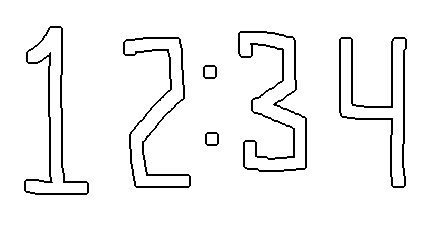
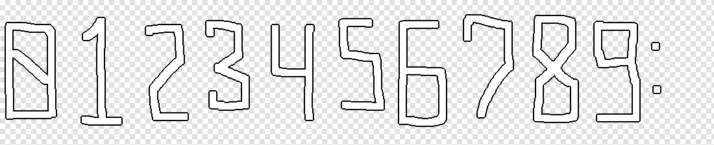
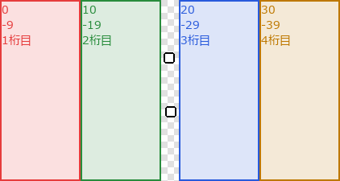
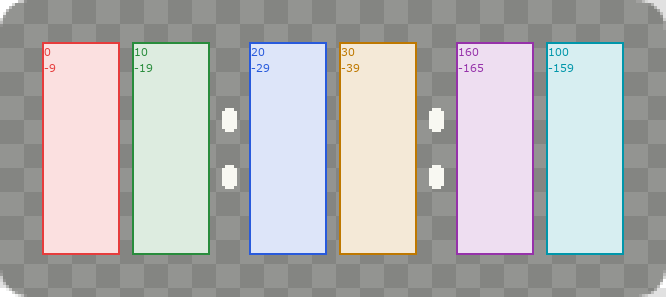
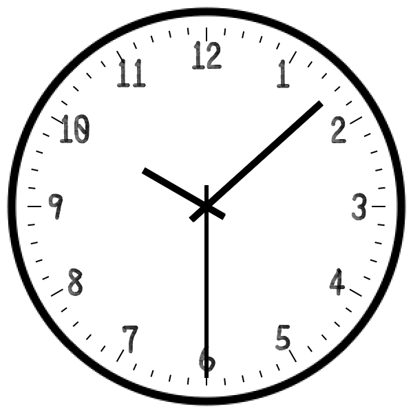
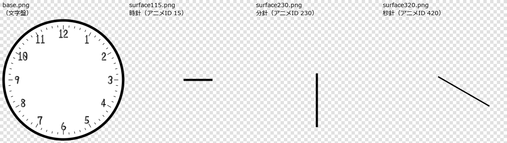
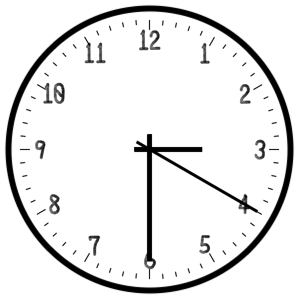

# うかくろっく 追加シェル作成ガイド

ゴースト「うかくろっく」（作者：ろすえん / lost_nd_xxx）用の追加シェルを作る方のための資料です。

- 公式ページ： <https://lnx.flop.jp/ukgk/clock.html>
- このガイドは、同梱のサンプルシェルを元に「何をどう作れば時計として動くか」をまとめたものです。

---

## 目次

1. [まず知っておくこと（全体像）](#1-まず知っておくこと全体像)
2. [作るシェルの種類を選ぶ](#2-作るシェルの種類を選ぶ)
   - [4 つのサンプルシェルの比較](#4-つのサンプルシェルの比較)
3. [共通：フォルダ構成と必須ファイル](#3-共通フォルダ構成と必須ファイル)
   - [3.1 流用してよいもの](#31-流用してよいもの)
   - [3.2 `descript.txt`](#32-descripttxt)
   - [3.3 `install.txt`](#33-installtxt)
   - [3.4 必須サーフェス](#34-必須サーフェス)
   - [3.5 その他のファイル](#35-その他のファイル)
4. [デジタル時計（時・分のみ）](#4-デジタル時計時分のみ)
   - [4.1 画像の構成](#41-画像の構成)
   - [4.2 アニメーション ID の割り当て](#42-アニメーション-id-の割り当て)
   - [4.3 `surfaces.txt` の書き方](#43-surfacestxt-の書き方)
   - [4.4 いちばん簡単な作り方 ① 数字画像を差し替える](#44-いちばん簡単な作り方-①-数字画像を差し替える)
   - [4.5 作り方 ② サイズや位置を変える](#45-作り方-②-サイズや位置を変える)
5. [デジタル時計（秒表示対応）](#5-デジタル時計秒表示対応)
   - [5.1 秒表示対応にするには](#51-秒表示対応にするには)
   - [5.2 必要なアニメーション ID](#52-必要なアニメーション-id)
   - [5.3 時刻の位置の対応](#53-時刻の位置の対応)
   - [5.4 ゴーストが送るスクリプト](#54-ゴーストが送るスクリプト)
   - [5.5 秒をシェルが自動で進める仕組み（上級者向け）](#55-秒をシェルが自動で進める仕組み上級者向け)
6. [アナログ時計](#6-アナログ時計)
   - [6.1 仕組み](#61-仕組み)
   - [6.2 判定](#62-判定)
   - [6.3 必須ID](#63-必須id)
   - [6.4 ゴーストが送る値](#64-ゴーストが送る値)
   - [6.5 秒針なしにする場合](#65-秒針なしにする場合)
   - [6.6 針画像の作り方（psd の使い方）](#66-針画像の作り方psd-の使い方)
   - [6.7 廃止した仕様（2023-06-18）](#67-廃止した仕様2023-06-18)
   - [6.8 アニメーションの書き方（アナログ）](#68-アニメーションの書き方アナログ)
7. [ゴーストが送るスクリプト一覧（リファレンス）](#7-ゴーストが送るスクリプト一覧リファレンス)
   - [デジタル](#デジタル)
   - [アナログ](#アナログ)
   - [更新タイミング](#更新タイミング)
8. [動作確認の方法](#8-動作確認の方法)
   - [8.1 SSP で実際に動かす](#81-ssp-で実際に動かす)
   - [8.2 さくらスクリプトで任意の時刻を表示する](#82-さくらスクリプトで任意の時刻を表示する)
   - [8.3 オフラインダンプで確認する（応用）](#83-オフラインダンプで確認する応用)
   - [8.4 よくある不具合](#84-よくある不具合)
9. [配布のしかた](#9-配布のしかた)
10. [チェックリスト](#10-チェックリスト)
11. [FAQ](#11-faq)
- [関連リンク](#関連リンク)

---

## 1. まず知っておくこと（全体像）

うかくろっくは、**「時刻に合わせてゴーストがさくらスクリプトを送り、シェルがそれに従って絵を組み立てる」** 仕組みです。
時刻の計算はゴースト側が行うので、時計として動かすために最低限必要なのは次の 2 つです。

1. **サーフェス 0**：時計本体。決められた**アニメーション ID** を `\i[ID]` で呼ぶと、その数字（や針）が表示される作りにしておく。
2. **サーフェス 10**：`\1` 側のデフォルト表示（見えなくてよいが、**無いとエラーになる**）。

ゴーストが送るスクリプトの基本形は次のとおりです（時刻 12:34 のデジタル時計の例）。

```
\1\s[10]\0\s[0]\i[1]\i[12]\i[23]\i[34]
```

| 部分 | 意味 |
| --- | --- |
| `\1\s[10]` | `\1` 側をサーフェス 10 にする（**サーフェス 10 が必須な理由**） |
| `\0\s[0]` | `\0` 側をサーフェス 0 にして、表示をいったんリセットする |
| `\i[1]` | 時の十の位が「1」→ アニメーション ID 1 |
| `\i[12]` | 時の一の位が「2」→ アニメーション ID 12 |
| `\i[23]` | 分の十の位が「3」→ アニメーション ID 23 |
| `\i[34]` | 分の一の位が「4」→ アニメーション ID 34 |

実際にこのスクリプトを流して撮ったのが次の画像です（シェル `master`）。



> つまり、時計として動かすための基本は **「アニメーション ID ごとに、正しい位置へ正しい画像を重ねる surfaces.txt を書く」** ことです。
> 画像だけ差し替えるのであれば、surfaces.txt はサンプルのままで済みます。

---

## 2. 作るシェルの種類を選ぶ

ゴーストは、**シェル名・シェルのフォルダ名**から、そのシェルの種類を自動判定します（`yaya_clock.txt` の `OnNotifyShellInfo`）。

| 種類 | 判定条件 | 参考にするサンプル |
| --- | --- | --- |
| 秒表示あり | シェル名に `seconds` を含む、**または** フォルダ名の末尾が `_seconds` | `digital_seconds` / `sample_analog_seconds` |
| アナログ | シェル名に `analog` を含む、**または** フォルダ名に `analog` を含む | `sample_analog_seconds` |
| デジタル（デフォルト） | 上記のどちらにも当てはまらない | `master` / `digital` |

- 「秒表示」と「アナログ」は**独立した判定**で、両方満たせば「秒表示つきアナログ」として動きます。
- どちらも **「両方の条件を満たしても対応扱い」** です（名前だけ・フォルダ名だけ、どちらでも可）。
- 英字は**小文字**で書いてください。**大文字は判定の対象になりません**（`Analog` / `SECONDS` などでは反応しません）。

> ⚠ **注意**：サンプル `sample_analog_seconds` は名前にもフォルダ名にも `seconds` を含みます。
> 「秒針のないアナログ」を作る場合は、**フォルダ名・シェル名から `seconds` を取り除いてください**（[6.5](#65-秒針なしにする場合) 参照）。

### 4 つのサンプルシェルの比較

| サンプル | 種類 | 表示 | 画像サイズ（ベース） | 数字サイズ |
| --- | --- | --- | --- | --- |
| `master` | デジタル | HH:MM | 422 × 225 | 100 × 225（コロン 22 × 225） |
| `digital` | デジタル | HH:MM | 448 × 180 | 99 × 180（コロン 12 × 180） |
| `digital_seconds` | デジタル＋秒 | HH:MM:SS | 222 × 99 | 26 × 71（コロン 5 × 71） |
| `sample_analog_seconds` | アナログ＋秒 | 時針・分針・秒針 | 600 × 600 | 針はすべて 600 × 600 |

---

## 3. 共通：フォルダ構成と必須ファイル

### 3.1 流用してよいもの

サンプルのうち、以下は**自由に流用してかまいません**。

- `surfaces.txt` / `descript.txt` / `install.txt` / `memo.txt` / `base.png`
- `sample_analog_seconds` は `readme.txt`（と `profile` 以下）を**除く全ファイル**が流用可能
  （`profile` は SSP などでゴーストを起動すると作られるユーザーデータです。配布には不要で、nar 作成時は SSP が自動で除外します）

流用したら、**配布前に**次の 3 つを書き換えてください。

- 作者名（`craftman` / `craftmanw` / `craftmanurl`）
- シェル名（`name`）
- シェルのフォルダ名（`install.txt` の `directory`）

> ネットワーク更新をすると、フォルダ `master` と `digital` は**配布元の最新状態に上書き**されます。
> 画像を差し替えたり、追加シェルを作る際は、**別のフォルダ名**にしてください。

### 3.2 `descript.txt`

```text
charset,UTF-8
type,shell
name,あなたのシェル名            // ←要変更
craftman,your_name               // ←要変更/省略可（半角）
craftmanw,あなたの名前           // ←要変更/省略可（全角可）
craftmanurl,https://example.com/ // ←要変更/省略可

sakura.seriko.alignmenttodesktop,free   // デスクトップ上を自由に移動可能にする
seriko.use_self_alpha,1                 // PNG 自身の透過情報を使う
```

- `seriko.use_self_alpha,1` の場合、**透過付き 32bit PNG** を使います。
  `0` にすると「左上 1px の色を透過色」または「pna」方式になります。
- `name` に `seconds` / `analog` を入れると、[種類の判定](#2-作るシェルの種類を選ぶ)に使われます。
- 上の `//` 以降は説明用です。実際のファイルでは、コメントは行頭に `//` を置いた別行で書いてください。

### 3.3 `install.txt`

```text
charset,UTF-8
type,shell
name,あなたのシェル名
accept,うかくろっく0
directory,your_shell_folder
```

| 項目 | 説明 |
| --- | --- |
| `accept,うかくろっく0` | このゴースト（`\0` 側の名前）にだけインストールを受け付けさせる |
| `directory` | インストール後のフォルダ名。**半角英数を推奨**。秒表示・アナログ判定にも使われるので注意 |

### 3.4 必須サーフェス

| サーフェス | 用途 |
| --- | --- |
| **0** | 時計本体 |
| **10** | `\1` のデフォルトサーフェス。**見えなくてもよいが、無いとエラーになる** |

サーフェス 10 は、**何らかの定義か画像、またはその両方**があれば足ります。サンプルの用意のしかたは、あくまで一例です。

- 例 ① `surface10.png`（10×10 の透明画像など）を置く（`master` / `digital` / `digital_seconds`）
- 例 ② `surfaces.txt` に `surface10 { element0,overlay,empty.png,0,0 }` と書く（アナログのサンプル）
- 上記以外に、何か別の仕掛けを組み込んでもかまいません。

### 3.5 その他のファイル

| ファイル | 用途 | 配布時 |
| --- | --- | --- |
| `thumbnail.png` | シェル選択画面などのプレビュー | 省略可 |
| `memo.txt` | 座標だけ変えたいとき用の surfaces.txt の雛形 | **削除する** |
| `surface0.png`（master のみ） | ゴーストキャプターさくら等のプレビュー用 | 基本的に不要。削除 |
| `psd/`（アナログのサンプル） | 針の作業用素材 | **フォルダごと削除** |

---

## 4. デジタル時計（時・分のみ）

サンプル：`master` / `digital`

### 4.1 画像の構成

数字 0〜9 とコロンを**同じ高さの別画像**にして、`base.png`（土台）の上に重ねます。



| ファイル | 内容 | `master` でのサイズ |
| --- | --- | --- |
| `base.png` | 土台。全体の大きさを決める | 422 × 225 |
| `n0.png`〜`n9.png` | 数字 | 100 × 225 |
| `nx.png` | 区切り（コロン） | 22 × 225 |

サンプルの `base.png` には**ごく薄い色がついています**。これは、透明部分をつかんでドラッグできるようにするためです。
ただし SSP の仕様変更により、**透明度が薄すぎると当たり判定が発生しなくなりました**。
境目は、**不透明度 3% と 4% の間**です（0〜100 で不透明度を指定する画像エディタでの確認結果）。
0〜255 で指定する場合は、約 7.7（3%）〜 10.2（4%）の間にあたります。
ドラッグできる領域が必要なら、**不透明度 4% 以上（0〜255 なら 11 以上）**を目安にしてください。
`master` / `digital` の `base.png` は、不透明度が 11/255（約 4.3%）になっています。
ご自身の環境で、実際につかめるかも確認してください。

### 4.2 アニメーション ID の割り当て

表示する 4 桁（HH:MM）を、**左から数えて 1〜4 番目の「位置」**として扱います。

| 位置 | アニメーション ID | 意味 | 数字 |
| --- | --- | --- | --- |
| 1 番目（時の十の位） | **0 〜 9** | その位置へ数字を置く | ID の一の位 = 表示する数字 |
| 2 番目（時の一の位） | **10 〜 19** | 〃 | 〃 |
| 3 番目（分の十の位） | **20 〜 29** | 〃 | 〃（※） |
| 4 番目（分の一の位） | **30 〜 39** | 〃 | 〃 |

※ ID 26〜29 は、現状の時計では使われませんが、将来の拡張のため定義されています（分の十の位は 0〜5 のため）。

`master` での位置は下図のとおりです。



つまり、**「12:34」は `\i[1]\i[12]\i[23]\i[34]`** で表せます。

### 4.3 `surfaces.txt` の書き方

`master/surfaces.txt` の構造（抜粋）：

```text
charset,UTF-8

descript
{
version,1
}

surface0
{
// 土台を確保
element0,base,base.png,0,0
// 間のコロン
element1,overlay,nx.png,200,0

// 左 1 個め（アニメ 0〜9）
animation0.interval,never
animation0.pattern0,overlay,100,0,0,0
animation1.interval,never
animation1.pattern0,overlay,101,0,0,0
...（9 まで）
// 左 2 個め（アニメ 10〜19）→ x=100 の位置
animation10.interval,never
animation10.pattern0,overlay,100,0,100,0
...
}

// 数字のサーフェス（0〜9 の画像を割り当て）
surface100 { element0,base,n0.png,0,0 }
surface101 { element0,base,n1.png,0,0 }
...
```

ポイント：

- `animationN.interval,never`：自動再生せず、`\i[N]` が呼ばれた時だけ動く。
- `animationN.pattern0,overlay,<サーフェスID>,0,<x>,<y>`：サーフェス `100`〜`109`（数字画像）を座標 `<x>,<y>` に重ねる。
- `100`〜`109` のサーフェスは**ゴーストからは直接指定されない**ため、番号やファイル名は変更可能です（変更する場合は surfaces.txt も書き換える）。
- **指定されるのは surface 0 のアニメーション ID 0〜39 と surface 10 のみ**です。

### 4.4 いちばん簡単な作り方 ① 数字画像を差し替える

`master` / `digital` と**同じサイズ**の数字画像（`n0.png`〜`n9.png`・`nx.png`）に差し替えるだけで、時計になります。

- `master`：数字 **100 × 225**、コロン **22 × 225**
- `digital`：数字 **99 × 180**、コロン **12 × 180**
- 32bit PNG（透過あり）で作ってください

### 4.5 作り方 ② サイズや位置を変える

`master/memo.txt` が「座標だけ変えたい人向けの surfaces.txt の雛形」です。

- 【x座標a】〜【x座標d】、【y座標a】〜【y座標d】を、エディタの置換機能で一括置換します（【】の記号も残さないようにしてください）。
- 位置 a=1 番目、b=2 番目、c=3 番目、d=4 番目、コロンは別にあります。
- 置換後は、`memo.txt` の中身を `surfaces.txt` として使います。**`memo.txt` は配布物から削除**してください。

`master` / `digital` の座標：

| シェル | コロン | 位置 a | 位置 b | 位置 c | 位置 d |
| --- | --- | --- | --- | --- | --- |
| master | (200, 0) | (0, 0) | (100, 0) | (222, 0) | (322, 0) |
| digital | (218, 0) | (0, 0) | (109, 0) | (240, 0) | (349, 0) |

> `digital` は 1 桁の幅が 99px、`master` は 100px、コロンの太さも違うため、座標はシェルごとに別です。


---

## 5. デジタル時計（秒表示対応）

サンプル：`digital_seconds`（シェル名「digital(秒表示対応)」）


### 5.1 秒表示対応にするには

次のどちらか（両方でもよい）を満たす名前にします。

- シェル名に `seconds` を含める
- フォルダ名の末尾を `_seconds` にする

### 5.2 必要なアニメーション ID

| ID 範囲 | 役割 |
| --- | --- |
| **0〜39** | 時・分（[第 4 章](#42-アニメーション-id-の割り当て)と同じ） |
| **100〜159** | 秒の**一の位**、カウントアップ（通常の時計） |
| **160〜165** | 秒の**十の位**、カウントアップ |
| **200〜259** | 秒の**一の位**、カウントダウン（キッチンタイマーなど） |
| **260〜265** | 秒の**十の位**、カウントダウン |

### 5.3 時刻の位置の対応

`13:00:00` の場合、次の位置に表示されます（`HH:MM:SS`）。

```
1 3 : 0 0 : 0 0
a b c d e f g h   ← memo.txt での記号（時2桁:分2桁:秒2桁）
```

`digital_seconds` では、base.png（222 × 99）の上に、26 × 71 の数字を y=14 の位置に並べています。



| 位置 | x 座標 | アニメ ID（カウントアップ） | アニメ ID（カウントダウン） |
| --- | --- | --- | --- |
| 時の十の位 | 14 | 0〜9 | 0〜9 |
| 時の一の位 | 44 | 10〜19 | 10〜19 |
| 分の十の位 | 83 | 20〜29 | 20〜29 |
| 分の一の位 | 113 | 30〜39 | 30〜39 |
| 秒の十の位 | 152 | 160〜165 | 260〜265 |
| 秒の一の位 | 182 | 100〜159 | 200〜259 |
| コロン 2 つ | (74, 14), (143, 14) | `element` で固定表示 | |

### 5.4 ゴーストが送るスクリプト

秒表示つきの時計（現在 12:34:57）：

```
\1\s[10]\0\s[0]\i[1]\i[12]\i[23]\i[34]\i[165]\i[157]
```

- `\i[16x]`：秒の十の位（`x` = 0〜5）
- `\i[1ss]`：秒の一の位（`ss` = 00〜59 → ID 100〜159）

カウントダウン（タイマー）は、`\i[26x]` と `\i[2ss]` を使います。

### 5.5 秒をシェルが自動で進める仕組み（上級者向け）

ゴーストが `\i[...]` を送るのは「**必要な時だけ**」で、毎秒送るわけではありません。
**あとはシェルのアニメーション連鎖で、勝手に次の秒へ進みます。** これがポイントです。

`surfaces.txt` の秒の一の位（カウントアップ）はこうなっています。

```text
animation100.interval,never
animation100.pattern0,overlay,100,0,182,14      // ① 0 を表示
animation100.pattern1,overlay,100,1000,182,14   // ② 1000ms 待つ
animation100.pattern2,start,101                  // ③ 次の ID(101) を開始
animation100.pattern3,overlay,-1                 // ④ 自分の表示を消す
animation101.interval,never
...
animation109.pattern2,parallelstart,(110,161)    // 9→0 の桁上がり：110 と十の位 161 を同時開始
animation109.pattern3,overlay,-1
animation109.pattern4,parallelstop,(160,162,163,164,165)  // 前の十の位を止める
```

- 1 秒（`1000`）経ったら `start` で次の ID に切り替え、自分は消えます。
- **桁上がりの時だけ**、`parallelstart` で十の位のアニメも同時に動かします（`109 → 110 & 161`）。
- 十の位は 10 秒（`10000`）表示してから次へ。
- **59 → 00** へ戻る箇所は、一の位は `159 → 100`、十の位は `165 → 160` へ戻すループにします。
  （分や時は、ゴーストが分の変わり目に `\i` を送り直して更新します。）

カウントダウン（200〜）は逆で、`201 → 200` のように ID が **減る** 向きに `start` します。

---

## 6. アナログ時計

サンプル：`sample_analog_seconds`



### 6.1 仕組み

文字盤（`base.png`）の上に、**針を 1 本ずつ別画像として 60 通り**用意し、`\i[ID]` で 1 本ずつ重ねます。
針の画像は**すべて文字盤と同じ大きさ（600×600）**で、針の位置は文字盤の中心にそろえて描かれています。



これらを重ねると完成です。



> **大きさについて**
> サンプルは 600 × 600 とやや大きめですが、`surfaces.txt` では針も文字盤もすべて座標 `0,0` に重ねていて、**座標の指定がありません**。
> そのため、画像の大きさを変えたいときに `surfaces.txt` を直す必要はありません。
> 文字盤と針を**同じ大きさ・同じ中心**で出力しなおせば、そのまま動きます。
> `psd/` の素材を丸ごと縮小して書き出す方法がおすすめです（手順は [6.6](#66-針画像の作り方psd-の使い方) の「全体の縮小」）。
> 作るシェルに合った大きさで、お好みに調整してください。

### 6.2 判定

シェル名またはシェルフォルダ名に `analog` を含めばアナログ扱いです。
**秒表示と共存できます**（秒針なしのアナログも作れます）。

### 6.3 必須ID

| アニメ ID | 針 | 意味 | 針画像（サンプル） |
| --- | --- | --- | --- |
| **0〜59** | 時針 | 0〜59 の 60 目盛り（12 時間 = 60 目盛り、**1 時間で 5 目盛り = 1 目盛り 12 分**） | `surface100`〜`159` |
| **200〜259** | 分針 | 0〜59 の 60 目盛り | `surface200`〜`259` |
| **400〜459** | 秒針 | 0〜59 の 60 目盛り（秒表示対応のみ） | `surface300`〜`359` |

- `surface0` は時計本体（`surfaces.txt`）、`surface10` は `\1` 用（`empty.png`）です。
- 秒針（400〜459）の定義は **`surfaces2.txt`**（`surface.append0` で `surface0` に追記）に分けてあります。
- 針画像のファイル名（`surface100.png` など）は、`surfaces.txt` 内で `overlay,100,...` として参照されている ID と対応しているだけです。**変更は可能**ですが、変更する場合は `surfaces.txt` も直してください。

### 6.4 ゴーストが送る値

通常の時計（現在時刻）の場合：

```
\1\s[10]\0\s[0]\i[時針ID]\i[分針ID]\i[秒針ID]
```

- 時針 ID ＝ `(時 % 12) × 5 + 分 ÷ 12`（0〜59）
  例：10:08 → `10×5 + 0 = 50`
- 分針 ID ＝ `分 + 200`
  例：08 分 → `208`
- 秒針 ID ＝ `秒 + 400`
  例：30 秒 → `430`

したがって、上の画像（10:08:30）は次のスクリプトで描画されます。

```
\1\s[10]\0\s[0]\i[50]\i[208]\i[430]
```

**タイマー（キッチン・ポモドーロ）の場合**は、「残り時間」を**文字盤の 12:00 から逆算した位置**に表示します。
残り時間が 0 に近づくほど、針は 12:00 に向かって**時計回りに進みます**。
残り時間を「時 `h`・分 `m`・秒 `s`」とすると、ID は次のとおりです。
（ゴーストは、この計算に使う残り時間を「終了時刻 − 現在時刻 − 1 秒」としています。終了直前の 1 秒未満のとき、秒針が 12:00:01 側へ入り込んでしまうのを避けるための措置です）

| 針 | 条件 | ID |
| --- | --- | --- |
| 時針 | 残り 0 | `0` |
| 時針 | それ以外 | `59 − h×5 − m÷12` |
| 分針 | 残り 0 | `200` |
| 分針 | `m` = 0 かつ 残り 60 秒以下 | `259` |
| 分針 | それ以外 | `59 − m + 200` |
| 秒針 | 残り 0 | `400` |
| 秒針 | `s` = 0 かつ 残り > 0 | `459` |
| 秒針 | それ以外 | `59 − s + 400` |

**例：デジタル表示なら残り 10 秒のキッチンタイマー**
アナログの計算には、デジタル表示より 1 秒少ない 9 秒が使われるので、時針 `59`、分針 `259`、秒針 `59 − 9 + 400 = 450` になります。
つまり、**11 時 59 分 50 秒**を指します。

```
\1\s[10]\0\s[0]\i[59]\i[259]\i[450]
```

（廃止した仕様は [6.7](#67-廃止した仕様2023-06-18) 参照）

秒表示非対応のシェルでは、秒針の `\i[4xx]` は送られません。

### 6.5 秒針なしにする場合

`sample_analog_seconds` をベースにして、次の対応をします。

1. `surface300.png`〜`surface359.png` を削除
2. `surfaces2.txt` を削除
3. **シェル名・フォルダ名から `seconds` を外す**（外さないと、ゴーストが秒針 `\i[4xx]` を送ってしまう）
4. フォルダ名・シェル名に `analog` を**必ず含める**

### 6.6 針画像の作り方（psd の使い方）

`psd/` に作業用ファイルがあります。

- `clock.psd`：FireAlpaca などで開けます。「〜〜の色柄」レイヤを描き換えると、部品の色を変えられます。
  PSDTool の独自拡張機能に対応しています。
- `hands_export.pfv`：PSDTool 用の設定ファイルです。

**針の一括出力手順**

1. PSDTool で `clock.psd` を開く
2. 全体の縮小と針の色変えを必要に応じて設定。それ以外のレイヤは非表示にする
3. 「お気に入り」タブの三本線ボタン →「インポート」から `hands_export.pfv` を開く
4. 「お気に入り」タブの三本線ボタン →「エクスポート」→「シンプルビューの全パターンをエクスポート」→「パーツ名なし/入れ子」を実行

> 配布する時は `psd/` フォルダごと削除してください。

### 6.7 廃止した仕様（2023-06-18）

次の ID は欠番になりました。ゴーストは直接指定しなくなったので、**他の用途に割り当ててもかまいません**。
（旧：タイマーは別 ID で逆回転させていた）

| 旧 ID | 旧用途 |
| --- | --- |
| 100〜159 | 時（1 時間で 5 目盛り**減**） |
| 300〜359 | 分（60000ms ごとに 1 目盛り減） |
| 500〜559 | 秒（1000ms ごとに 1 目盛り減） |

### 6.8 アニメーションの書き方（アナログ）

```text
animation0.interval,never
animation0.pattern0,overlay,100,0,0,0        // 針の画像を表示
animation0.pattern1,overlay,100,720000,0,0   // 待機（時針は 720000ms）
animation0.pattern2,start,1,0,0,0            // 次の目盛りへ
animation0.pattern3,overlay,-1               // 自分を消す
```

- 分針は 60000ms（1 分）、秒針は 1000ms（1 秒）ごとに 1 目盛り進める定義です。
- 時針は 720000ms（12 分）で 1 目盛り進める定義です（1 時間で 5 目盛り）。
  バルーンを出したままの時でも時計がある程度自動で進むのは、このアニメーションの連鎖によるものです。ずれはゴースト側が送り直す `\i` で補正されます。
- 針が重なる順序を揃えるために、`descript` ブロックに `animation-sort,ascend`（ID の小さい方を手前にする）を指定しています。
  時針（0〜）が一番手前、秒針（400〜）が一番奥になります。

---

## 7. ゴーストが送るスクリプト一覧（リファレンス）

`yaya_clock.txt` の `OnRefreshClock_Exec` が組み立てるスクリプトの一覧です。

### デジタル

| 状況 | スクリプト |
| --- | --- |
| 通常（時・分） | `\1\s[10]\0\s[0]` + `\i[h1]` `\i[1h2]` `\i[2m1]` `\i[3m2]` |
| 通常（秒表示対応） | 上 + `\i[16s1]` `\i[1ss]` |
| タイマー（秒表示対応） | 上（時・分は残り時間） + `\i[26s1]` `\i[2ss]` |

`h1` `h2` = 時の十・一の位、`m1` `m2` = 分の十・一の位、`s1` = 秒の十の位、`ss` = 秒 2 桁。
タイマーの残り時間が 1 時間未満の場合、時は `00` になります。

### アナログ

| 状況 | スクリプト |
| --- | --- |
| 通常 | `\1\s[10]\0\s[0]\i[時針]\i[分針]`（秒表示対応なら `\i[秒針]` を追加） |
| 時針 | `(時%12)×5 + 分÷12`（0〜59） |
| 分針 | `分 + 200` |
| 秒針 | `秒 + 400` |
| タイマー | 時針・分針・秒針とも「12:00 までの残り」で計算（詳細は [6.4](#64-ゴーストが送る値) の表） |

### 更新タイミング

- 通常：分が変わるたび（秒表示対応は秒単位の補正も入る）
- タイマー中：毎秒チェックし、必要なときにだけ送信
- アラーム・時報・ポモドーロの通知（`\_q` バルーン、`trayballoon`、`\_v` 音声）は、時計表示とは独立した処理です。シェル側で特別な対応をする必要はありません。

---

## 8. 動作確認の方法

### 8.1 SSP で実際に動かす

1. 作ったシェルフォルダを、ゴースト「うかくろっく」の `shell` フォルダ（ゴースト直下）に置く
2. SSP でうかくろっくを起動し、右クリック → シェルの切り替えで選ぶ
3. 時計が表示されるか確認する
4. 秒表示・アナログ判定が正しいか確認する

### 8.2 さくらスクリプトで任意の時刻を表示する

SSP の開発者パレットや SSTP などから、次のスクリプトを送ると、任意の時刻の表示を確認できます。
（ゴーストが次回更新するまでは表示が保たれます）

デジタル（12:34）：

```
\0\s[0]\i[1]\i[12]\i[23]\i[34]\e
```

秒表示つきデジタル（12:34:57）：

```
\0\s[0]\i[1]\i[12]\i[23]\i[34]\i[165]\i[157]\e
```

アナログ（10:08:30）：

```
\0\s[0]\i[50]\i[208]\i[430]\e
```

### 8.3 オフラインダンプで確認する（応用）

ここまでの確認方法（8.1・8.2）だけで十分に作れます。この節は、**コマンドラインに慣れている方向けの補助手段**です。
SSP には、ゴーストを起動せずに `surfaces.txt` を読み込み、サーフェス画像を書き出す「オフラインダンプ」機能があります。
画像の出力と、`surfaces.txt` の書き間違いのチェックができます。

- 詳しい説明： <https://ssp.shillest.net/ukadoc/ssphelp/option.html#offline-dump>
- `--dump-animation` を使うには、SSP 2.9.05 以降が必要です。

以下の `<SSP のフォルダ>` と `<ゴーストのフォルダ>` は、環境に合わせて置き換えてください（`<ゴーストのフォルダ>` は `shell` フォルダの 1 つ上です）。

**`surfaces.txt` の書き間違いをチェックする**（画像は出力しません）

```text
"<SSP のフォルダ>\ssp.exe" --offline-dump "<ゴーストのフォルダ>" --dump-shell シェルのフォルダ名 --dump-error-log "C:\dump\error.csv"
```

エラーや警告があれば `error.csv` に書き出されます（何もなければファイルは作られません）。
行番号つきで出るので、どの行が問題かを探せます。

**特定の数字（や針）を表示した状態の画像を書き出す**

```text
"<SSP のフォルダ>\ssp.exe" --offline-dump "<ゴーストのフォルダ>" --dump-shell シェルのフォルダ名 --dump-surface-list "0" --dump-animation 12 --dump-output-dir "C:\dump"
```

- `--dump-animation 12` は、`\i[12]` を送った状態（デジタル時計なら「時の一の位が 2」）の画像を出力します。
- `C:\dump` に、アニメーションなしの `surface0.png` と、アニメーション適用後の `surface0_0000.png` が出力されます。
- 指定できるアニメーション ID は **1 つだけ**です。複数の桁を同時に重ねた画像は出力できないため、桁ごとに位置を確かめたい時に使います。
- 秒表示のように `start` で他のアニメーションを起動するものは、起動先は出力されません。

複数の桁をまとめて見たい場合は、8.2 のさくらスクリプトで SSP 上に表示するのが簡単です。

### 8.4 よくある不具合

| 症状 | 原因 |
| --- | --- |
| エラーが出る | `surface10` が無い |
| 数字が出ない | アニメ ID の対応が違う / 画像が透過 PNG でない |
| 秒が動かない | 名前 / フォルダ名に `seconds` が入っていない |
| アナログが数字表示になる | 名前 / フォルダ名に `analog` が入っていない |
| 秒針が出ない | `surfaces2.txt` や `surface300〜359` が足りていない |

---

## 9. 配布のしかた

1. **作者名・シェル名・フォルダ名**を自分のものに変更したか確認する
2. 不要ファイルを削除する（`memo.txt`、`psd/`、`surface0.png`（master 由来）など）
3. `install.txt`（`type,shell` / `accept,うかくろっく0` / `directory,…`）を同梱する
4. nar を作る（次のどちらか）
   - SSP にシェルフォルダを**ドラッグ＆ドロップ**する
   - SSP の**シェルエクスプローラ**を開き、作成したシェルを**右クリック**して nar を作成する
   - どちらも、`profile` フォルダは**自動で除外**されます
5. 秒表示・アナログの種類（[第 2 章](#2-作るシェルの種類を選ぶ)）に応じた名前になっているか再確認する

> ネットワーク更新で上書きされないよう、**`master` / `digital` というフォルダ名は避ける**ことをおすすめします。

---

## 10. チェックリスト

**共通**

- [ ] 作者名・シェル名・フォルダ名を変更した
- [ ] `descript.txt` に `charset,UTF-8` が書かれている
- [ ] `install.txt` の `accept,うかくろっく0` と `directory` が正しい
- [ ] `surface0` と `surface10` がある（[3.4 必須サーフェス](#34-必須サーフェス)を参照）
- [ ] 透過付き 32bit PNG を使っている（`seriko.use_self_alpha,1` の場合）
- [ ] 不要ファイル（`memo.txt`・`psd/`・`surface0.png`）を削除した
- [ ] `thumbnail.png` を入れた（任意）

**デジタル**

- [ ] アニメ ID 0〜39 が定義されている
- [ ] 数字 0〜9 とコロン画像がそろっている

**秒表示**

- [ ] 名前に `seconds`、またはフォルダ名の末尾が `_seconds`
- [ ] アニメ ID 100〜165、200〜265 が定義されている
- [ ] 59 → 00、9 → 0 のループが正しい

**アナログ**

- [ ] 名前またはフォルダ名に `analog`
- [ ] アニメ ID 0〜59（時）、200〜259（分）が定義されている
- [ ] 秒針あり：400〜459 と針画像がそろっている／なし：`surfaces2.txt` と 300〜359 を削除し、`seconds` を名前から外した

---

## 11. FAQ

**Q. 画像だけ差し替えたいのですが、txt の改造は必要ですか？**
A. 数字の大きさを `master` / `digital` と同じにして、32bit PNG で作るなら不要です。大きさを変える場合は `memo.txt` の座標置換を使います。

**Q. なぜ透明なところもドラッグできるのですか？**
A. サンプルの `base.png` に、ごく薄い色がついているためです。ここも描き換えられます。ただし SSP の仕様変更で、不透明度が 4% 未満（0〜255 なら 10 以下）だと当たり判定が無くなります（[4.1](#41-画像の構成)参照）。

**Q. `surface0.png` は何に使われていますか？**
A. `master` にだけあります。ゴーストキャプターさくらなどのプレビュー用で、追加シェル配布時には基本的に不要です。

**Q. `thumbnail.png` は何に使われていますか？**
A. シェル変更時などのプレビュー用です。省略可能です。

**Q. バルーンが消えている時に、1〜2 秒のずれが出ます。**
A. 秒表示対応シェルでは、バルーンが消えている間に 1〜2 秒のうちに補正されるずれが出ることがあります。それ以外の乱れは、作者までご連絡いただけると助かります。

**Q. シェルのメニューを開いている間や、インストール中に表示が乱れます。**
A. その間は、時刻表示の遅延・乱れ、アラームや時報の通知の遅延が起こりえます。

**Q. どこへ連絡すれば？**
A. 作者：ろすえん（lost_nd_xxx）、<https://lnx.flop.jp/>

---

## 関連リンク

- うかくろっく公式ページ： <https://lnx.flop.jp/ukgk/clock.html>
- SSP 公式仕様書（UKADOC）： <https://ssp.shillest.net/ukadoc/manual/>
- PSDTool： <https://oov.github.io/psdtool/>
- FireAlpaca： <https://firealpaca.com/ja/>

---

> この文書は、AI（Claude Code）の補助を受けて作成しました。内容は作者（ろすえん）が確認し、責任を負います。誤りや不明点があれば、作者までご連絡ください。 <https://lnx.flop.jp/>
